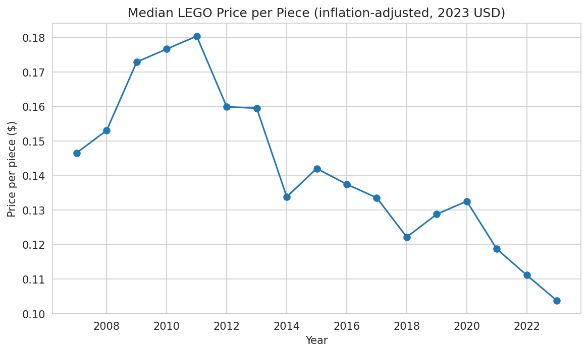
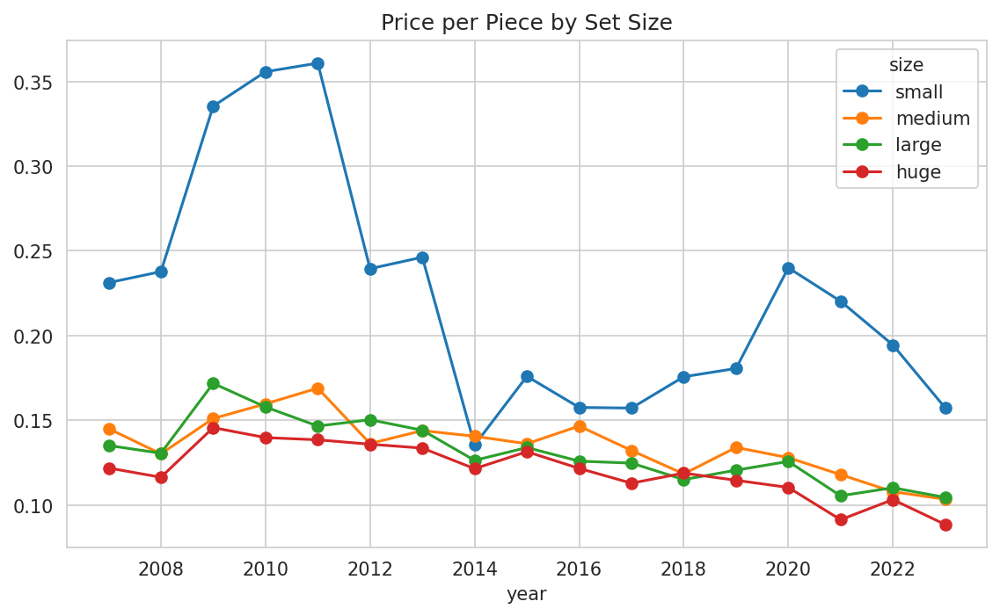
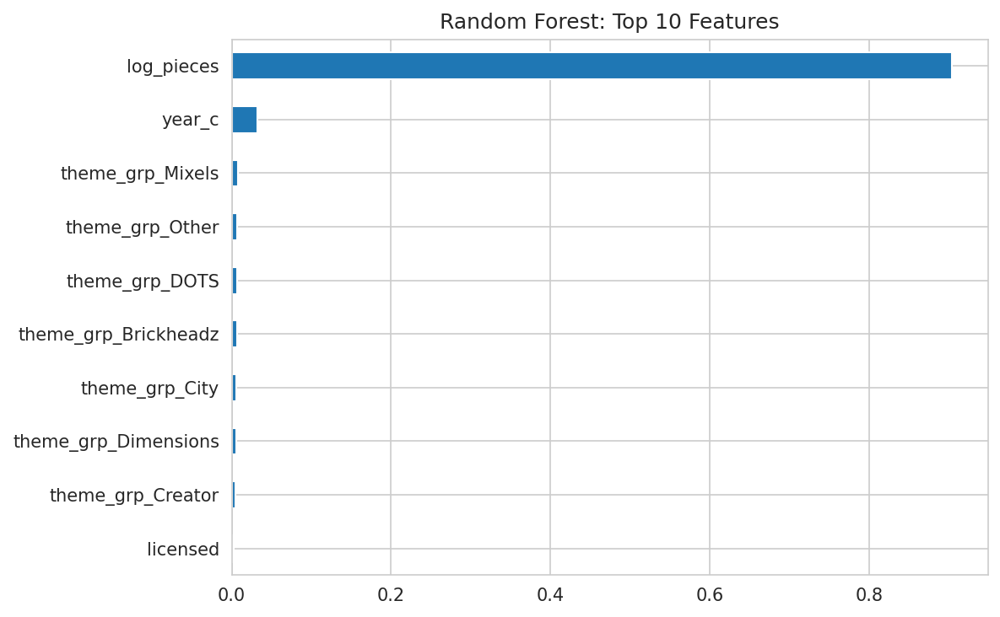

# What Drives LEGO Set Prices? (2007-2023)

**Question:** Does piece count predict LEGO set price, and how has price per piece changed over time?

**Tools:** Python, pandas, matplotlib, seaborn, statsmodels, scikit-learn

## Key Findings
1. **Price rises with piece count, but less than proportionally.** A 10% increase in pieces raises price by about 6%, so bigger sets are cheaper per piece.
2. **Real prices fell about 2.3% per year** (inflation-adjusted, 2023 USD), controlling for size and theme. Price per piece for medium, large, and huge sets dropped about 30% from 2011 to 2023.
3. **Theme matters beyond size.** At the same piece count and year, Dimensions sets cost about 21% more than the baseline, while Mixels, DOTS, and Brickheadz cost 55-70% less.
4. **A random forest predicts price better than linear regression** (R² 0.90 vs. 0.74, MAE about $12 vs. $21). Piece count accounts for about 90% of the forest's feature importance.

## Data
- **Rebrickable** (sets, themes): [link]
- **Kaggle "kagglesetsdb"** (retail prices, piece counts): [link]
- **FRED CPIAUCSL** (US inflation data): [link]

## Method
1. Merged the three datasets on set number (14,101 of 14,936 Kaggle sets matched).
2. Dropped sets with missing or zero price/pieces (5,342 rows left), then kept 2007-2023 only, since earlier years had too few price records.
3. Removed non-building themes (Duplo, Gear, Collectible Minifigures, Seasonal).
4. Adjusted prices for inflation (2023 USD).
5. Grouped sub-themes under their top-level theme.
6. Fit a log-log linear regression and a random forest on the same train/test split.

## Limitations
- About 59% of sets had no MSRP and were dropped, so results may not represent all sets.
- Regression residuals are not normal (some outliers).
- Theme coefficients depend on the baseline ("Other"), and random forest importance can understate dummy-coded themes.
- Resale price was left out on purpose to keep the project focused.

## How to Run
1. Download the datasets from the links above.
2. Open `lego_price_analysis.ipynb` in Google Colab.
3. Run all cells from top to bottom.
